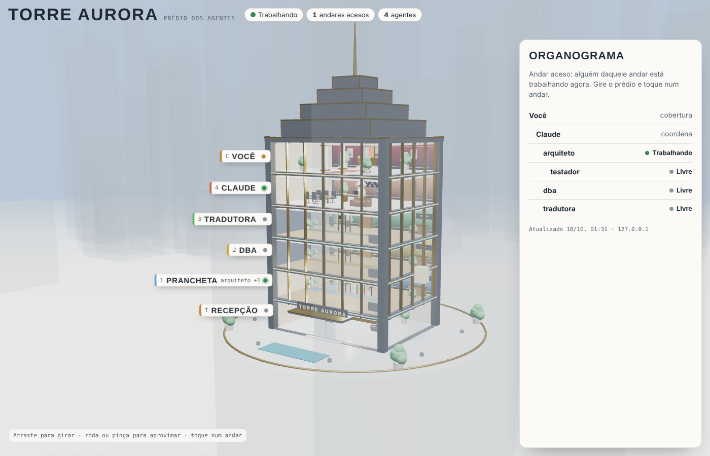
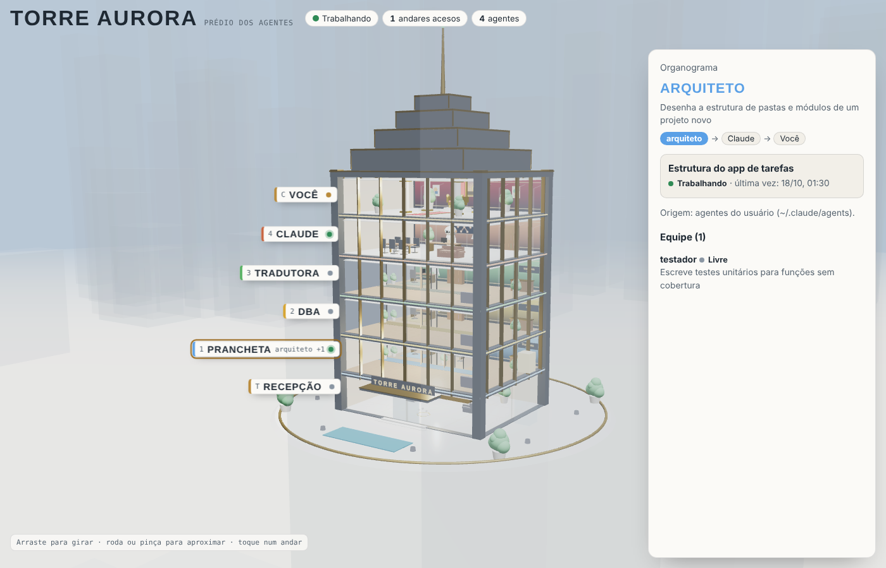

# TowerAgent

Um prédio 3D com um andar para cada agente do Claude Code. Instale, rode `/tower "Nome do Prédio"` e o prédio aparece no navegador com os seus agentes. Criou um agente novo? O prédio ganha um andar sozinho. O Claude chamou um agente? O andar dele acende até a tarefa terminar.



## Instalar (Claude Code)

```
/plugin marketplace add HiveControlAgents/TowerAgent
/plugin install toweragent@toweragent
```

Depois, em qualquer projeto:

```
/tower Torre Aurora
```

O nome fica salvo. Da próxima vez, só `/tower` abre o mesmo prédio. Endereço: http://127.0.0.1:7979/

Precisa de Python 3.8 ou mais novo (`python3` ou `python`). Não há dependências para instalar.

## Sem o plugin

```
git clone https://github.com/HiveControlAgents/TowerAgent
cd TowerAgent
python3 scripts/tower.py serve --nome "Torre Aurora"          # ao vivo, abre o navegador
python3 scripts/tower.py build --nome "Torre Aurora" -o torre.html   # arquivo único para compartilhar
python3 scripts/tower.py listar                                # o que vai aparecer, sem abrir nada
```

Opções úteis: `--dono "Seu nome"` (quem mora na cobertura), `--porta 8080`, `--projeto caminho/do/projeto`, `--sem-abrir`.

## Como o prédio se monta

| Andar | Quem |
|---|---|
| Cobertura | você (o trono é seu) |
| Penúltimo | Claude, que coordena |
| 1 a N | um andar para cada agente |
| Térreo | recepção, com o nome do prédio no letreiro |

Os agentes vêm de três lugares: `~/.claude/agents/` (seus), `.claude/agents/` (do projeto aberto) e os plugins instalados. A decoração de cada andar (acessório do robô, telas, piso) é escolhida pela descrição do agente: um agente de código ganha telas com código, um de dados ganha gráficos, um de nuvem ganha servidores.



### Campos opcionais no cabeçalho do agente

```yaml
---
name: testador
description: Escreve testes unitários
color: orange              # cor do andar (red, blue, green, yellow, purple, orange, pink, cyan ou #rrggbb)
tower_chefe: arquiteto     # vira salinha no andar do arquiteto, em vez de andar próprio
tower_andar: Laboratório   # nome do andar na recepção e no rótulo
tower_cargo: Testes        # texto pequeno na placa da porta
---
```

Veja exemplos em [`exemplos/agents/`](exemplos/agents/).

## Privacidade

- O prédio lê **só o cabeçalho** de cada agente (nome, descrição, cor e os campos `tower_*`). O prompt, que fica abaixo do segundo `---`, nunca é lido.
- A descrição é cortada em 160 caracteres e qualquer coisa com cara de chave (`sk-…`, `ghp_…`, `AKIA…`, `token: …`, `senha: …`) vira `[oculto]`.
- Os hooks gravam só o nome do agente, o status, a hora e a descrição curta da tarefa (80 caracteres) em `~/.toweragent/estado.json`. O prompt da tarefa não é gravado.
- O servidor escuta apenas em `127.0.0.1`. Nada é enviado para fora. A página só baixa o Three.js e as fontes de CDNs públicos.
- `build` gera um HTML com esses mesmos dados. Confira com `listar` antes de compartilhar o arquivo.

## Como o andar acende

O plugin instala hooks em `PreToolUse`, `PostToolUse` e `PostToolUseFailure` da ferramenta de agentes, e em `SubagentStart`/`SubagentStop`. Eles marcam o agente como trabalhando, livre ou com erro. A página consulta o estado a cada 4 segundos. Um trabalho sem fim registrado por mais de 30 minutos volta a contar como livre.

## Desenvolvimento

```
python3 -m unittest discover -s tests -v
claude plugin validate .
```

Licença MIT. Feito com Three.js 0.128.
